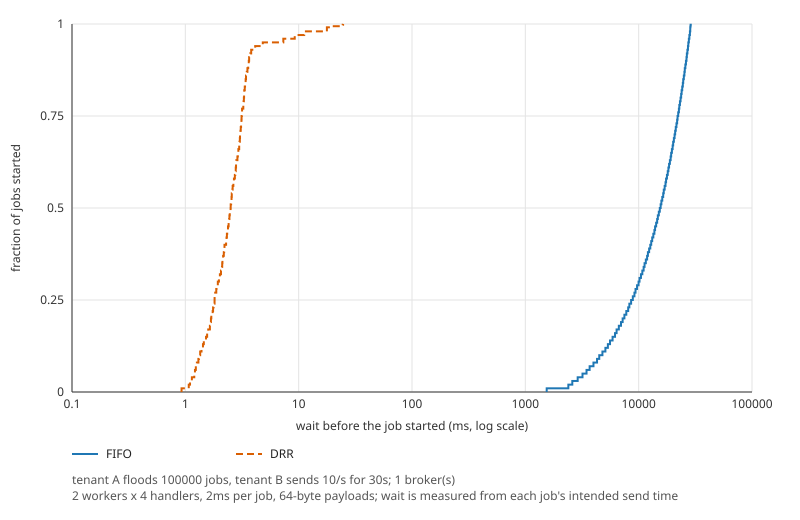

# Distributed Durable Job Queue

A distributed job queue for Go services, backed by PostgreSQL: leased at-least-once delivery with fencing tokens, weighted fair scheduling across tenants, and a deterministic simulator that proves it.

## What it is

Producers enqueue jobs over gRPC to a set of stateless brokers. The brokers keep every job in one PostgreSQL table and hand jobs to workers as leases: a worker asks for work (a long poll), keeps its lease alive with heartbeats while its handler runs, and acknowledges the result. A lease that is not renewed expires and the job runs again, after a backoff, until it succeeds or uses up its attempts.

Delivery is **at-least-once**. A worker can stall past its lease, or an acknowledgement can be lost, so a job can run more than once, and no queue that crosses a network can promise otherwise. What this one promises is that only the newest lease holder can change a job: every lease carries a fencing token that grows by one, and the broker turns away any report that carries an older one. A downstream system that keeps the highest token it has seen for a job, or that is idempotent, then sees each effect **once**: the delivery is at-least-once and the effect is "effectively once". Without such a sink you have at-least-once, and nothing more.

The scheduler shares each queue between tenants by weight (deficit round robin), so one tenant's flood does not starve the others. The Go SDK provides the producer and the worker, `jobqueuectl` is the admin CLI, and a Helm chart deploys the brokers, with KEDA scaling the workers on the backlog. The decision logic is written as pure state machines, and a deterministic simulator runs it against crashes, stalls, partitions and message loss, checking the invariants after every step. Every CI run replays 500 seeds of it.

Requirements: Go 1.26 or newer, PostgreSQL 15 to 18, Linux or macOS.

## Quick start

You need a PostgreSQL database. This uses a local one and a broker on a loopback address, where no TLS or tokens are required.

```sh
createdb jobqueue
export JOBQUEUE_DATABASE_URL='postgres://localhost:5432/jobqueue?sslmode=disable'

go build -o bin/ ./cmd/jobqueue-server ./cmd/jobqueuectl

bin/jobqueuectl migrate        # applied=2 version=2
bin/jobqueue-server --grpc-addr 127.0.0.1:7070 --database-url "$JOBQUEUE_DATABASE_URL"
```

A producer and a worker, each in a program of its own. These are the bodies of `ExampleProducer_Enqueue` and `ExampleNewWorker` in [example_test.go](example_test.go), which `go test` compiles, so they match the SDK:

```go
ctx := context.Background()

conn, err := jobqueue.Dial("127.0.0.1:7070", jobqueue.WithInsecure())
if err != nil {
	log.Fatal(err)
}
defer func() { _ = conn.Close() }()

producer := jobqueue.NewProducer(conn, jobqueue.ProducerOptions{Tenant: "acme"})
res, err := producer.Enqueue(ctx, jobqueue.EnqueueParams{
	Queue:          "thumbnails",
	Payload:        []byte(`{"seed": 7, "size": 1024}`),
	IdempotencyKey: "thumbnail-7",
})
if err != nil {
	log.Fatal(err)
}
fmt.Printf("job %d, deduplicated: %t\n", res.ID, res.Deduplicated)

info, err := producer.Get(ctx, res.ID)
if err != nil {
	log.Fatal(err)
}
fmt.Printf("job %d is %s after %d of %d attempts\n", info.ID, info.State, info.Attempts, info.MaxAttempts)
```

```go
conn, err := jobqueue.Dial("127.0.0.1:7070", jobqueue.WithInsecure())
if err != nil {
	log.Fatal(err)
}
defer func() { _ = conn.Close() }()

worker := jobqueue.NewWorker(conn, jobqueue.WorkerOptions{Queue: "thumbnails", Concurrency: 16})
err = worker.Handle(func(ctx context.Context, j *jobqueue.Job) error {
	// j.Token() is the fencing token of this lease. Send it with every
	// write to a downstream system, and have that system refuse a write
	// whose token is lower than one it has already seen for the job.
	fmt.Printf("job %d, attempt %d, token %d: %s\n", j.ID, j.Attempt, j.Token(), j.Payload)
	j.SetResult([]byte("done"))
	return nil
})
if err != nil {
	log.Fatal(err)
}

// Run returns after ctx ends and the running handlers have finished or
// been given back.
ctx, stop := signal.NotifyContext(context.Background(), os.Interrupt, syscall.SIGTERM)
defer stop()
if err := worker.Run(ctx); err != nil {
	log.Fatal(err)
}
```

Or from the command line:

```sh
bin/jobqueuectl --insecure --addr 127.0.0.1:7070 enqueue --queue thumbnails --payload-string hello
bin/jobqueuectl --insecure --addr 127.0.0.1:7070 get 1
bin/jobqueuectl --insecure --addr 127.0.0.1:7070 stats --queue thumbnails
```

A broker that listens on anything but a loopback address refuses to start without TLS and a tokens file, unless it is given `--insecure`. [docs/operations.md](docs/operations.md) covers tokens, TLS, every flag and the metrics.

## A zombie worker, fenced

Worker A leases job 7 under fencing token 1. It is paused by a long garbage collection, a stopped container or a partition, and its heartbeats stop. With the defaults (lease 30 s, margin 3 s, heartbeat every 7.5 s) the story goes like this:

| Time | What happens |
| --- | --- |
| 0 s | A leases the job. Its token is 1. |
| 27 s | A's three heartbeats failed. Its local deadline, lease time + 30 s - 3 s, passes and the SDK cancels the handler's context. This handler ignores it. |
| 30 s | The lease expires on the database clock. |
| about 31 s | A broker's reaper takes the job back (every second); after a backoff of at most one second B leases it. B's token is 2. |
| 32 s | B writes its result and completes the job. |
| 40 s | A wakes up, writes with token 1 and reports completion. Both are turned away. |

The result table of the downstream system is what makes the write safe. It keeps the highest token it has seen and replaces a row only for a higher one:

```sql
INSERT INTO sink (job_id, token, written_by) VALUES ($1, $2, $3)
ON CONFLICT (job_id) DO UPDATE SET token = EXCLUDED.token, written_by = EXCLUDED.written_by
WHERE sink.token < EXCLUDED.token
```

A's write changes zero rows, so the handler learns that it was superseded, and the broker answers A's `Complete` with `FENCED`. The job ends `succeeded` under token 2. `TestPGZombieWorkerIsFenced` in `e2e_pg_test.go` runs this story on real brokers over PostgreSQL with short leases and checks the table, the job and the broker's counters. `TestWorkerUncooperativeHandlerIsFenced` in `worker_test.go` is the in-process version.

The broker does this much for any worker: it refuses the late report. Making the write to your own database or API safe takes the token, which is why `Job.Token()` exists. [ADR 0002](docs/design/0002-leases-and-fencing.md) has the argument.

## Guarantees

Each guarantee, the mechanism behind it and the tests that prove it. Tests named `TestPG...` need a database and the `pg` build tag, `TestChaos` needs the `chaos` tag and a Docker PostgreSQL, and `TestE2E` needs the `e2e` tag and a kind cluster; [docs/testing.md](docs/testing.md) says how to run every layer.

| Guarantee | Mechanism | Proved by |
| --- | --- | --- |
| A job whose worker dies is not lost: it runs again | Every broker runs a reaper once a second. An expired lease counts as a failed attempt: the job is ready again after a backoff, or dead when its attempts are used up | `TestReapRecordsLeaseExpired` in `internal/core/job/transition_test.go`<br>`TestPGConformanceMaintenance` in `internal/store/pgstore/pgstore_pg_test.go`<br>`TestReaperReapsExpired` in `internal/broker/maintenance_test.go` |
| Only the newest lease holder can change a job | `lease_epoch` grows by one on every lease and is the fencing token. Heartbeat, Complete, Fail and Release apply only to a job that is leased under that token | `TestTransitionMatrix` in `internal/core/job/transition_test.go`<br>`TestConformance` in `internal/store/memstore/memstore_test.go` (subtests `CompleteStaleTokenFenced`, `HeartbeatStaleTokenIsFenced`)<br>`TestPGConformanceAck` in `internal/store/pgstore/pgstore_pg_test.go`<br>`TestWorkerUncooperativeHandlerIsFenced` in `worker_test.go`<br>`TestPGZombieWorkerIsFenced` in `e2e_pg_test.go` |
| Expiry is for liveness, not correctness | A Complete under the current token is accepted even after the lease expired, as long as nobody leased the job since. A Heartbeat on an expired lease is refused and does not revive it | `TestTransitionBoundaries` in `internal/core/job/transition_test.go`<br>`TestConformance` in `internal/store/memstore/memstore_test.go` (subtests `CompleteAfterExpiryBeforeReapSucceeds`, `HeartbeatAtExpiryIsExpired`, `ReapAtExactExpiry`) |
| A worker stops trusting a lease before the broker can give the job away | The local deadline is anchored at the instant the request was sent, never at the response, and lies a margin before expiry. The broker reports the time the call waited up to the start of the fetch that produced the job, so the send instant plus that wait is never later than the database's clock when it set the expiry | `TestGrantDeadlineAnchorsAtSendTime` in `internal/core/lease/tracker_test.go`<br>`TestDeadlineIgnoresResponseLatency` in `internal/core/lease/tracker_test.go`<br>`TestWorkerHeartbeatDeadlineIsAnchoredAtTheSendTime` in `worker_test.go`<br>`TestTrackerProperties` in `internal/core/lease/property_test.go`<br>`TestDispatcherAnswersWithTheWaitUpToTheFetch` in `internal/broker/dispatcher_test.go` |
| Two heartbeats in a row can be lost without losing the lease | Heartbeats go out every TTL/4, and the TTL must be greater than four times the margin. A heartbeat call that hangs is cut off after one period, so it does not hold up the next. The third heartbeat goes out with TTL/4 minus the margin to spare, 4.5 s at the defaults, and its answer must come back within that time; near the smallest TTL that a margin allows, the spare time shrinks towards nothing | `TestTwoLostHeartbeatsSurvive` in `internal/core/lease/tracker_test.go`<br>`TestSmallestLegalTTLSurvivesTwoLostHeartbeats` in `internal/core/lease/tracker_test.go`<br>`TestHeartbeatCallsAreBoundedByOnePeriod` in `internal/core/lease/tracker_test.go`<br>`TestWorkerSurvivesTwoHungHeartbeatsAtTheSmallestLegalTTL` in `worker_test.go`<br>`TestConfigValidate` in `internal/core/lease/tracker_test.go` |
| Retries are bounded and spread out | A budget of `max_attempts` (25 by default). The wait grows from 1 s by doubling to 1 h, with full jitter. A release gives the attempt back | `TestFailExhaustsBudget` in `internal/core/job/transition_test.go`<br>`TestCeilingSumOverDefaultRetries` in `internal/core/job/backoff_test.go`<br>`TestDelayIsFullJitter` in `internal/core/job/backoff_test.go`<br>`TestReleaseRefundsAttempt` in `internal/core/job/transition_test.go` |
| Enqueue can be repeated safely | An idempotency key names one job within its tenant and queue while the row exists. The SDK adds a random key to every call and retries it | `TestConformance` in `internal/store/memstore/memstore_test.go` (subtests `EnqueueIdempotencyKeyIsScopedByTenantAndQueue`, `EnqueueBatchDedupWithinBatch`, `EnqueueKeyReusableAfterPrune`)<br>`TestPGEnqueueIsAtomic` in `internal/store/pgstore/pgstore_pg_test.go`<br>`TestProducerGeneratesIdempotencyKey` in `producer_test.go` |
| One clock decides every expiry | The database clock, `jobqueue.now()`, is read once per statement. Brokers and workers never compare a wall clock with a database timestamp | `TestPGEachStatementReadsTheClockOnce` in `internal/store/pgstore/pgstore_pg_test.go`<br>`TestPGTestClockControlsNow` in `internal/store/pgstore/migrate/migrate_pg_test.go`<br>`TestWriteCallsReadTheClockOnce` in `internal/store/memstore/memstore_test.go` |
| A noisy tenant cannot starve the others | Deficit round robin over the tenants with work, in turns of 8 jobs times the tenant's weight. A tenant's share never drifts from its weighted share by more than one turn, and the plan does not depend on the batch size | `TestPlanShareBound` in `internal/core/fair/drr_test.go`<br>`TestPlanBatchIndependence` in `internal/core/fair/drr_test.go`<br>`TestDispatcherDRRServesSmallTenant` in `internal/broker/dispatcher_test.go`<br>`TestPGNoisyNeighbor` in `e2e_pg_test.go` |
| A long poll never leaks a waiter or strands a job | Every waiter is answered at its deadline, on cancel and on drain. Jobs fetched for a caller that went away are released, and the attempt is refunded | `TestCancelDuringFetchReleases` in `internal/core/dispatch/dispatch_test.go`<br>`TestDrainAnswersEveryWaiter` in `internal/core/dispatch/dispatch_test.go`<br>`TestDispatcherReleasesOrphanedGrants` in `internal/broker/dispatcher_test.go` |
| Wakeups follow the amount of work, not the number of waiters, and a queue is called empty only when it is | Every dispatch event starts at most one fetch, and a full batch chains the next waiter. Under fair scheduling a short fetch for named tenants proves only that those tenants ran dry: they leave the ring and the next waiter is chained. Only a short fetch across all tenants marks the queue empty, and the store's `Activity` and `Lease` agree on what is ready | `TestNotifyStartsOneFetchPerNotification` in `internal/core/dispatch/dispatch_test.go`<br>`TestFullFetchChainsToNextWaiter` in `internal/core/dispatch/dispatch_test.go`<br>`TestShortFetchClosesTheQueueOnlyIfItAskedAcrossTenants` in `internal/core/dispatch/dispatch_test.go`<br>`TestDispatchProperties` in `internal/core/dispatch/property_test.go`<br>`TestDispatcherShortPlannedFetchChainsTheNextWaiter` in `internal/broker/dispatcher_test.go`<br>`TestConformance` in `internal/store/memstore/memstore_test.go` (subtest `ActivityListsOnlyTenantsThatLeaseCanServe`)<br>`TestPGConformanceMaintenance` in `internal/store/pgstore/pgstore_pg_test.go` (the same subtest) |
| NOTIFY is a hint, never the source of truth | A fallback poll (1 s) and a resync after every reconnect find work that a lost notification would have announced | `TestDispatcherPollFindsWorkWithoutNotify` in `internal/broker/dispatcher_test.go`<br>`TestPGListenerReconnectsAndResyncs` in `internal/broker/listener_pg_test.go` |
| Hostile or oversized input never reaches the table | Names, sizes, delays and keys are validated by the broker and again by the store, and the schema has CHECK constraints behind them | `TestValidateName` in `internal/core/job/validate_test.go`<br>`TestServerRejectsBadNames` in `internal/broker/server_test.go`<br>`TestServerEnqueueSizeLimits` in `internal/broker/server_test.go`<br>`TestPGConstraintsRejectInconsistentRows` in `internal/store/pgstore/migrate/migrate_pg_test.go` |
| A caller can do only what its token allows | A producer token is bound to a tenant, a worker token to queues, and only an admin may do the rest. Tokens are stored as hashes. A broker on a non-loopback address refuses to start without TLS and tokens | `TestServerEveryRPCChecksRole` in `internal/broker/server_test.go`<br>`TestServerTenantScope` in `internal/broker/server_test.go`<br>`TestValidateRefusesInsecureNonLoopback` in `internal/broker/config_test.go`<br>`TestLoadTokensRejectsMalformed` in `internal/broker/auth_test.go` |
| A rolling restart drops no call | A draining broker fails `/readyz`, refuses new Lease calls so that the SDK moves to another broker, and keeps serving heartbeats and acknowledgements until its grace period ends | `TestPGBrokerGracefulShutdown` in `internal/broker/broker_pg_test.go`<br>`TestServerDrainingLeaseUnavailable` in `internal/broker/server_test.go`<br>`TestWorkerSwitchesBrokerOnUnavailable` in `worker_test.go`<br>`TestPGRollingBrokerRestart` in `e2e_pg_test.go` |
| A worker shuts down without losing work | It stops leasing, waits up to the drain timeout (25 s) for its handlers, then gives the rest back with their attempts refunded | `TestWorkerDrainWaitsForRunningHandlers` in `worker_test.go`<br>`TestWorkerDrainReleasesAfterTimeout` in `worker_test.go` |
| The decision logic cannot read a clock, open a socket or start a goroutine | `internal/core` may import only the standard library minus the packages that perform effects, and contains no `go`, `select` or channel. A test over the import graph and the syntax tree enforces it | `TestRepositoryHasNoViolations` in `internal/archtest/archtest_test.go` |
| The binary and the schema agree | Migrations are embedded, forward-only and applied once under an advisory lock. A broker refuses to start against another schema version | `TestPGMigrateConcurrentUp` in `internal/store/pgstore/migrate/migrate_pg_test.go`<br>`TestPGBrokerRefusesSchemaMismatch` in `internal/broker/broker_pg_test.go` |
| A queue name from a request cannot grow the metrics without bound | Only the first 100 queue names get a label of their own; later ones share the label `other` | `TestQueueLabelCapsCardinality` in `internal/broker/metrics_test.go` |
| The hot statements stay on their indexes | Lease, reap and prune reach their rows through partial indexes, not through a scan of the table | `TestPGHotStatementsDoNotScanTheTable` in `internal/store/pgstore/pgstore_pg_test.go` |
| A delayed job never starts before its run time, and is found without waiting for the poll | A job can be leased only once the database clock has reached its `run_at`. Nothing announces that moment, so the store reports when the next scheduled job falls due and the dispatcher arms a timer for it, and the activity read finds the job as well. Neither waits for the fallback poll. The PostgreSQL test sets the poll to 5 s and requires each job to start no earlier than its delay and within 2 s after it | `TestDueAtWakes` in `internal/core/dispatch/dispatch_test.go`<br>`TestDispatcherDelayedJobWakesAtDue` in `internal/broker/dispatcher_test.go`<br>`TestDispatcherDueTimeWakesWithoutLaterActivity` in `internal/broker/dispatcher_test.go`<br>`TestPGDelayedJobsRunOnTime` in `e2e_pg_test.go` |
| Safety and liveness hold under crashes, stalls, partitions, loss and clock drift | A deterministic simulator runs the real dispatch, fair and lease cores over the reference store, and checks eight safety invariants after every event and two liveness invariants after healing. A run is a function of its seed, and each batch must be rough enough to count | `TestSimSeeds` in `internal/sim/run_test.go`<br>`TestSimRegressionSeeds` in `internal/sim/run_test.go`<br>`TestCheckerAlarms` in `internal/sim/checker_test.go` |
| PostgreSQL answers like the reference store | Random operation sequences, with the clock moving, reaping and pruning, run against both stores, and every answer and the whole table are compared after each step | `TestPGDifferential` in `internal/store/pgstore/diff_pg_test.go` |
| No double lease, no duplicate key, no lost job under contention | Leases pick rows with `FOR UPDATE SKIP LOCKED`, the idempotency key is a unique index, and an acknowledgement locks its rows in id order | `TestPGConcurrentLeaseNoDoubleGrant` in `internal/store/pgstore/concurrency_pg_test.go`<br>`TestPGConcurrentEnqueueSameKey` in `internal/store/pgstore/concurrency_pg_test.go`<br>`TestPGConcurrentAckRacesReap` in `internal/store/pgstore/concurrency_pg_test.go`<br>`TestPGConcurrentConservation` in `internal/store/pgstore/concurrency_pg_test.go`<br>`TestPGOppositeOrderHeartbeatsDoNotDeadlock` in `internal/store/pgstore/retry_pg_test.go` |
| The tests can fail: every planted flaw turns its named tests red | Nine defects, planted at fourteen sites behind the `jobqueue_flaws` build tag, and a CI job (`scripts/check-flaws.sh`, over the table in `scripts/flaws.tsv`) that requires each one to fail the tests named for it and the build that carries them to pass when none is selected. No flaw may lack a row | `TestEveryFlawHasARow` in `internal/flaw/table_test.go` |
| Real processes keep the guarantees under fault injection | Three brokers, four workers and a fault-injecting proxy, with `kill -9`, `SIGSTOP`, delays, partitions and PostgreSQL restarts, and a history of what every process saw, checked for S1, S4, S7 and L1 against the final state | `TestChaos` in `test/chaos/chaos_test.go`<br>`TestCheckAlarms` in `internal/history/checker_test.go` |
| A cluster loses nothing to a pod loss, a rolling restart or autoscaling | The Helm chart, the image, the example worker and the KEDA scaler on a kind cluster: a broker pod deleted and every broker restarted under load with no job lost, and the worker scaled from zero to many and back | `TestE2E` in `test/e2e/e2e_test.go` |
| Autoscaling follows the backlog | The scaler counts a queue's ready and leased jobs, never the scheduled ones, so KEDA does not scale workers to zero while they hold leases | `TestScalerBacklogCountsReadyAndLeasedNotScheduled` in `internal/broker/scaler_test.go`<br>`TestScalerIsActive` in `internal/broker/scaler_test.go` |
| The example sink refuses an older token | One conditional `INSERT ... ON CONFLICT DO UPDATE ... WHERE token < EXCLUDED.token` keeps the highest token seen for each job | `TestPGFencedSinkRejectsOlderToken` in `examples/thumbnail/sink_pg_test.go` |

What is not guaranteed:

- **Exactly-once execution.** See above: a job can run more than once.
- **Knowing the outcome of an Enqueue whose context ended.** If the caller's context is cancelled or its deadline passes while `Enqueue` is in flight, the job may or may not have been committed. The key that the SDK generates lasts for one call, so a new call after that can make a second job: pass your own `IdempotencyKey` to retry safely. A client that calls the gRPC API directly and sends no key can duplicate a job in the same way.
- **Execution order.** Within a tenant, jobs are dispatched in `(run_at, id)` order as a best effort. With several brokers and workers that order is not guaranteed, and the order in which concurrent workers finish is not either.
- **Global fairness across brokers.** Every broker shares its own fetches by weight; the shares add up across brokers, which is only approximately fair.
- **Results over 64 KiB, payloads over 256 KiB.** Keep large data elsewhere and put a reference in the job.

## Performance

Throughput, enqueue-to-start latency, the noisy-neighbour wait with and without fair scheduling, recovery time after a worker or broker is killed, and the behaviour of the table over a long run are measured with `jobqueue-bench` on one laptop: an Apple M2 with 16 GB of memory, with PostgreSQL 17 on the same machine. The figures below are medians of three runs (the soak ran once), and every one of them comes from [docs/benchmarks.md](docs/benchmarks.md), which holds the method, the exact commands, the spread of the runs and the raw output.

- **Throughput.** One broker sustained 3,781 jobs per second (2,844 to 4,250 over three runs), and at half of that rate the enqueue-to-start latency was 0.97 ms at p50 and 19 ms at p99. Three brokers on the same machine did not triple it: 4,250 jobs per second (4,250 to 6,125).
- **What the optimisations buy.** Batched leases raise the sustained rate by a factor of 1.6 and coalesced acknowledgements by 1.4. With `NOTIFY`, a job on an idle queue starts after 5.4 ms at p50, against 498 ms with polling alone.
- **A noisy neighbour.** While another tenant floods the queue with 100,000 jobs, a small tenant's p99 wait is 18 ms under deficit round robin and 28.5 s under first-come-first-served (p50: 2.6 ms and 15.4 s).
- **Recovery.** The 100 jobs of a killed worker all ran again about 32 s after the kill, inside the bound of 33 s for a lease TTL of 30 s. Cutting one of three brokers off under load cost one to three failed calls and no job.
- **A soak.** At 1,890 jobs per second throughput did not drift (+0.17%). The first half-hour run, with the table's original settings, did not level off: autovacuum's cost throttle made a vacuum of the jobs table take 47 s at the median of the 60 s it has, and the table grew from 442 MiB to 569 MiB in the last three minutes. With the throttle's delay removed (migration 0002) a vacuum takes 0.69 s at the median, and a 60-minute run held the table at 367.6 MiB at minute 30 and 376.6 MiB at minute 60 (+2.45%).
- **River as a reference.** River, run as a library with no network hop, sustained 10,250 jobs per second (10,250 to 11,469), 2.7 times one broker.



These are the numbers of one laptop with PostgreSQL beside the benchmark, and the maxima move by up to a factor of 1.5 between runs; the file lists what they do and do not say, including the profile of the notify lock that PostgreSQL takes for every committing `NOTIFY`.

## What is not covered

The suite does not test failover and replica promotion of PostgreSQL, multi-region setups, a worker clock whose frequency drifts beyond the margin model, malicious (byzantine) workers, PostgreSQL's own durability, or performance on hardware other than the laptop of the benchmarks. The simulator re-implements the wiring around the pure cores, so a separate multi-process chaos test covers the real broker and SDK. [docs/testing.md](docs/testing.md) lists what each layer catches and what it does not.

## Deployment

The image and the Helm chart are built by the release workflow. The chart in `deploy/helm/jobqueue` runs the brokers as a Deployment of two replicas, behind a headless Service for client-side load balancing, with readiness and liveness probes, a PodDisruptionBudget, a preStop sleep and a pre-install and pre-upgrade hook that runs `jobqueuectl migrate`.

```sh
kubectl create secret generic jobqueue-database --from-literal=url='postgres://...'
helm install jobqueue deploy/helm/jobqueue \
  --set tokens.secretName=jobqueue-tokens \
  --set tls.secretName=jobqueue-tls
```

The Secrets must exist first; the chart creates none. For a test cluster on a trusted network, `--set insecure=true` replaces the tokens and the TLS.

Workers are scaled with [KEDA](https://keda.sh): the broker serves KEDA's external scaler protocol on its own port, `--scaler-addr`, and reports the backlog of a queue (ready plus leased jobs), so a `ScaledObject` can take a worker Deployment from zero to N and back. The chart renders one for the example thumbnail worker with `--set example.enabled=true --set example.keda.enabled=true` (and `example.tokenSecret` and `example.tokenKey` when the brokers require tokens). The scaler port is unauthenticated, plaintext gRPC, because KEDA does not send tokens: it must stay inside the cluster, and the chart's NetworkPolicy admits it only from the KEDA namespace. [docs/operations.md](docs/operations.md) has the values, the Secrets and what to check when scaling does not happen.

## Documentation

- [docs/architecture.md](docs/architecture.md): the components, the life of a job, the dispatch path and the data model.
- [docs/design](docs/design/0001-postgres-as-source-of-truth.md): the design records, with the alternatives that were rejected.
- [docs/operations.md](docs/operations.md): running it, and what to do at 3 a.m.
- [docs/testing.md](docs/testing.md): the test layers, the planted flaws and how to reproduce a failing seed.
- [docs/benchmarks.md](docs/benchmarks.md): the measurements.
- [CONTRIBUTING.md](CONTRIBUTING.md), [SECURITY.md](SECURITY.md), [CHANGELOG.md](CHANGELOG.md) and [RELEASING.md](RELEASING.md).

## License

Apache License 2.0. Copyright 2026 Jason Te. See [LICENSE](LICENSE).
